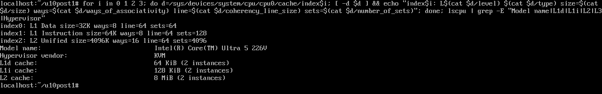
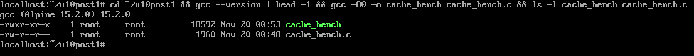
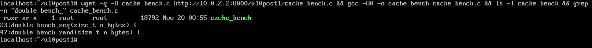
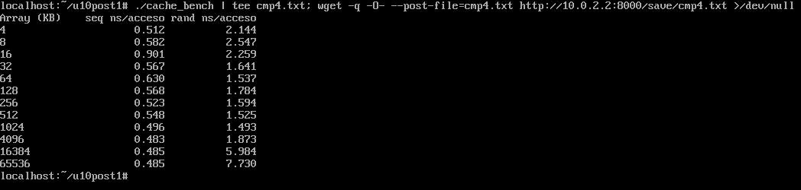
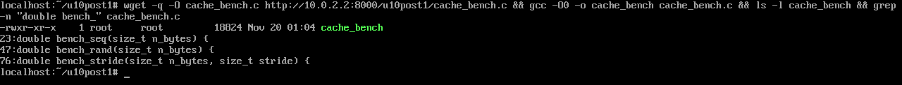
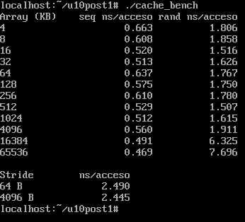

# salas-post1-u10 — Memorias del computador: jerarquía de caché y memoria virtual

**Autor:** César Hernán Salas Peñaranda  
**Curso:** Arquitectura de Computadores — Unidad 10, post-contenido (laboratorio en dos partes)  
**Repositorio único:** `salas-post1-u10`

Este repositorio reúne las dos partes del laboratorio de memoria en lenguaje C sobre Linux. La Parte 1 mide con un benchmark propio el efecto de la jerarquía de caché sobre la latencia de acceso, incluido un patrón con stride fijo que expone conflictos de asociatividad. La Parte 2 examina la memoria virtual de un proceso Linux a través de `/proc`, el comportamiento del page fault agregado y el costo de un page fault individual con `mmap`.

## Entorno de trabajo

| Componente | Detalle |
|---|---|
| Sistema anfitrión | Windows 11 Home, procesador Intel Core Ultra 5 226V, 16 GB de RAM |
| Hipervisor | VirtualBox 7.2.22 |
| Máquina virtual | `U10-Alpine`: 2 CPU, 2048 MB de RAM, red NAT, sin disco |
| Sistema invitado | Alpine Linux 3.24.4 (kernel 6.18.60-lts) arrancado en modo *live* desde el ISO, con `root` sin contraseña |
| Compilador | `gcc` 15.2.0 (musl libc 1.2.6) |
| Herramientas | `pmap`, `vmstat` y `free` (`procps-ng`), `/usr/bin/time` (GNU `time`), `lscpu` (`util-linux`) |

La guía recomienda Ubuntu 20.04 o equivalente. El estudiante reutilizó el ISO de Alpine que ya tenía de la Unidad 5 y creó una VM nueva y desechable, sin tocar la del laboratorio anterior. Alpine usa **musl** en lugar de glibc, así que en los mapas de memoria de la Parte 2 la librería de C aparecerá como `libc.musl-x86_64.so.1` y el cargador como `ld-musl-x86_64.so.1`, en lugar de `libc.so` y `ld-linux.so`.

Los paquetes se instalaron con `apk` desde los repositorios oficiales de Alpine:

```
apk add gcc musl-dev procps-ng time util-linux
```

Los archivos `.c` se escriben en el anfitrión, dentro de este repositorio, y la VM los descarga desde un servidor HTTP local temporal que solo la VM alcanza (`10.0.2.2`). Los resultados se leen en la consola de la VM y se capturan con `VBoxManage controlvm screenshotpng`, que captura únicamente la pantalla de la VM.

## Estructura del repositorio

```
salas-post1-u10/
├── README.md
├── u10post1/       # Parte 1: cache_bench.c
├── u10post2/       # Parte 2: mymaps.c, pagefault_demo.c, mmap_fault_cost.c
└── capturas/       # capturas de la consola de la VM, nombradas pN_cpM_descripcion.png
```

---

# Parte 1 — Benchmark de jerarquía de caché

## Paso 1 — Configuración del entorno y detección de caché

El estudiante creó el directorio de trabajo y consultó la topología de caché que el kernel expone en `/sys/devices/system/cpu/cpu0/cache/`:

```
mkdir -p ~/u10post1 && cd ~/u10post1
for i in 0 1 2 3; do
   echo -n "Cache level $i: "
   cat /sys/devices/system/cpu/cpu0/cache/index${i}/size 2>/dev/null || echo "N/A"
done
```

Además de los tamaños, leyó la geometría de cada nivel (nivel, tipo, vías, tamaño de línea y número de sets), porque la decisión técnica del Paso 5 depende de ella.

| Nivel | Tipo | Tamaño | Vías | Línea | Sets |
|---|---|---|---|---|---|
| L1 (`index0`) | Datos | 32 KB | 8 | 64 B | 64 |
| L1 (`index1`) | Instrucciones | 64 KB | 8 | 64 B | 128 |
| L2 (`index2`) | Unificada | 4096 KB (4 MB) | 16 | 64 B | 4096 |
| L3 (`index3`) | — | N/A | — | — | — |

**Observaciones.**

- La caché L1 de datos es de 32 KB, de 8 vías y con líneas de 64 bytes: 32 KB / (8 vías × 64 B) = 64 sets. Es exactamente la geometría de ejemplo que usa la guía en las decisiones técnicas.
- **La VM no expone una caché L3**: `index3` no existe, y por eso el bucle de la guía imprime `N/A` en el nivel 3. Los valores son los que el hipervisor presenta al invitado, que pueden diferir de la jerarquía física del procesador; el anfitrión (Windows) informa 8 MB de L3 para este procesador, pero esa información no llega a la VM. Esto se tiene en cuenta al interpretar los saltos del benchmark.
- `lscpu` confirma que el invitado corre sobre un hipervisor (`KVM`) y que ve 2 CPU.

**Checkpoint 1.** Tamaños detectados: L1d = 32 KB, L2 = 4 MB, L3 = no expuesta por la VM.




## Paso 2 — Benchmark de latencia por tamaño de array, acceso secuencial (`cache_bench.c`)

`cache_bench.c` reserva un array de `n_bytes`, lo toca con `memset` antes de medir (para que las páginas ya estén en RAM) y lo recorre secuencialmente 100 veces (`REPEAT`) leyendo un byte por iteración. El tiempo se mide con `clock_gettime(CLOCK_MONOTONIC)` y se reporta en **ns por byte**. El puntero es `volatile` y el programa se compila con `-O0`, para que el compilador no elimine unas lecturas que no tienen efecto observable. Los tamaños se expresan con las constantes `KB` y `MB`, agrupados con un comentario por nivel de caché.

```
gcc -O0 -o cache_bench cache_bench.c && ./cache_bench
```

### Resultados

Se ejecutó el benchmark tres veces seguidas (ns/byte). La primera es la de la captura.

| Array (KB) | Región | Corrida 1 | Corrida 2 | Corrida 3 | Promedio |
|---|---|---|---|---|---|
| 4 | L1 | 0.865 | 2.838 | 1.421 | 1.708 |
| 8 | L1 | 0.706 | 1.145 | 1.351 | 1.067 |
| 16 | L1 | 0.648 | 1.242 | 0.518 | 0.803 |
| 32 | L1 (límite) | 0.656 | 1.070 | 0.663 | 0.796 |
| 64 | L2 | 0.703 | 1.025 | 0.736 | 0.821 |
| 128 | L2 | 0.655 | 0.877 | 0.567 | 0.700 |
| 256 | L2 | 0.671 | 0.719 | 0.528 | 0.639 |
| 512 | L2 | 0.669 | 0.724 | 0.535 | 0.643 |
| 1024 | L2 | 0.672 | 0.720 | 0.540 | 0.644 |
| 4096 | L2 (límite) / L3 | 0.559 | 0.639 | 0.588 | 0.595 |
| 16384 | RAM | 0.536 | 0.549 | 0.543 | 0.543 |
| 65536 | RAM | 0.540 | 0.580 | 0.553 | 0.558 |

### Interpretación

Los puntos de transición esperados según el checkpoint 1 son 32 KB (fin de L1d) y 4 MB (fin de L2). **En esta máquina no se observan los saltos de latencia que anticipa la guía**: el costo por byte es prácticamente constante, entre 0.5 y 0.9 ns, y las corridas más ruidosas solo muestran valores altos en los arrays más pequeños (4 y 8 KB), que se atribuyen al arranque en frío de la medición (la CPU todavía está subiendo de frecuencia y el kernel de la VM está atendiendo otras tareas), no a un efecto de la jerarquía de caché. Los valores incluso bajan ligeramente con el tamaño. Las causas más probables son:

- **Localidad espacial.** Una línea de caché tiene 64 bytes y el recorrido es byte a byte, de modo que de cada 64 accesos solo uno cae en una línea nueva; el costo del fallo se reparte entre 64 lecturas.
- **Prefetch de hardware.** Un recorrido secuencial es el patrón más fácil de predecir: el prefetcher del procesador trae las líneas siguientes antes de que se pidan, y oculta la latencia de L2, L3 y RAM.
- **Costo del propio bucle con `-O0`.** Sin optimización, cada iteración carga y guarda `i` y `n_bytes` en la pila además de leer el byte `volatile`. Ese costo fijo, del orden de medio nanosegundo por byte, es mayor que lo que aporta el nivel de memoria desde el que se sirve cada línea.
- **Entorno virtualizado.** La VM presenta su propia jerarquía de caché y comparte el procesador físico con Windows, lo que añade ruido a las medidas.

**Checkpoint 2.** El programa compila sin errores con `gcc -O0` y mide la latencia secuencial con `clock_gettime`, pero la tabla **no muestra saltos discernibles** que se correspondan con L1, L2 y L3. El estudiante lo documenta tal como se observó y lo explica con la localidad espacial y el prefetching, en lugar de forzar un resultado.




## Paso 3 — Acceso aleatorio frente a secuencial (`bench_rand`)

El acceso aleatorio destruye la localidad espacial. `bench_rand` reserva un array de `int`, un vector de índices `idx` que se mezcla con Fisher–Yates y recorre el array en el orden de `idx` (`sum += arr[idx[i]]`). Devuelve ns por acceso, donde un acceso es la lectura de un `int`. `main()` ejecuta ahora `bench_seq` y `bench_rand` con los mismos tamaños y los imprime en dos columnas. Ambos se miden por acceso, uno por byte y el otro por `int`, de modo que son comparables como "tiempo por lectura".

```
gcc -O0 -o cache_bench cache_bench.c && ./cache_bench
```

**Condiciones de medida.** Las corridas del Paso 2 se hicieron antes de conectar el portátil a la corriente. Durante un intento posterior la VM llegó a registrar un `soft lockup` de CPU y las medidas se dispararon, así que el estudiante conectó el cargador y repitió el experimento esperando a que cada corrida terminara antes de usar la consola. Los datos de este paso salen de tres corridas con el portátil conectado; la columna secuencial resulta mucho más estable que en el Paso 2 (0.47 a 0.53 ns para todos los tamaños de 16 KB en adelante), lo que confirma que el ruido de los arrays de 4 y 8 KB del Paso 2 venía de la máquina y no de la caché.

### Resultados (promedio de tres corridas, ns por acceso)

| Array (KB) | Región | Secuencial | Aleatorio | Aleatorio / secuencial |
|---|---|---|---|---|
| 4 | L1 | 0.528 | 2.300 | 4.4 |
| 8 | L1 | 0.735 | 1.723 | 2.3 |
| 16 | L1 | 0.588 | 1.619 | 2.8 |
| 32 | L1 (límite) | 0.528 | 1.550 | 2.9 |
| 64 | L2 | 0.535 | 1.481 | 2.8 |
| 128 | L2 | 0.506 | 1.742 | 3.4 |
| 256 | L2 | 0.516 | 1.592 | 3.1 |
| 512 | L2 | 0.528 | 1.545 | 2.9 |
| 1024 | L2 | 0.477 | 1.448 | 3.0 |
| 4096 | L2 (límite) | 0.486 | 1.830 | 3.8 |
| 16384 | RAM | 0.484 | 5.984 | 12.4 |
| 65536 | RAM | 0.476 | 7.789 | 16.4 |

El valor de 4 KB aleatorio (2.300) lo infla una sola corrida atípica (3.741 ns); las otras dos dan 1.572 y 1.586.

### Interpretación

- **Secuencial: sin saltos.** El costo se mantiene en torno a 0.5 ns por byte desde 4 KB hasta 64 MB. Se explica por la localidad espacial y el prefetch: el patrón es completamente predecible y el procesador trae las líneas por adelantado.
- **Aleatorio: dos escalones.** Hasta 1 MB el costo es de unos 1.5 ns por acceso, unas tres veces el secuencial, y se mantiene casi plano mientras el array cabe en la L2 de 4 MB. Al pasar a 16 MB sube a casi 6 ns y a 64 MB a casi 8 ns, entre 12 y 16 veces el secuencial. En el aleatorio cada acceso es probablemente una línea distinta, por lo que ya no se amortiza el fallo de caché entre 16 lecturas (una línea de 64 B contiene 16 `int`) ni intervienen los prefetchers.
- **Qué se atribuye a cache miss y qué a TLB miss.** El salto de 4 MB a 16 MB coincide con salir de la L2 detectada en el checkpoint 1 (4 MB), y se atribuye a *cache miss* (los datos se sirven desde un nivel inferior de la jerarquía). Al mismo tiempo, 16 MB equivale a 4096 páginas de 4 KB, más de las que cubre el TLB, de modo que cada acceso aleatorio paga además una traducción que ya no está en el TLB (*TLB miss*, con recorrido de la tabla de páginas). El pequeño aumento de 1 MB a 4 MB (1.45 a 1.83 ns) apunta a que el TLB de primer nivel ya no basta. Con este experimento no se pueden separar del todo ambos efectos, porque el array crece en los dos sentidos a la vez; la caída de rendimiento medida es la suma de los dos.
- **Escalón sin una L3 visible.** La VM no expone L3, así que el único límite claro es el de la L2 (4 MB). El aumento de 16 MB a 64 MB (de 6.0 a 7.8 ns) se atribuye a que la jerarquía física del anfitrión sigue contando con niveles más profundos y con la RAM.

**Checkpoint 3.** La comparativa muestra que el acceso aleatorio tiene una latencia significativamente mayor para arrays que superan la caché (hasta 16 veces la secuencial), y la interpretación anterior atribuye cada salto a cache miss o TLB miss.




## Paso 4 — Benchmark con stride para exponer conflictos de asociatividad (`bench_stride`)

Con un stride fijo (salto constante entre direcciones consecutivas), si el stride coincide con *tamaño de la caché / número de vías*, todos los accesos caen en el mismo set y compiten por sus vías, produciendo *conflict misses* aunque el array completo quepa en la caché. `bench_stride(n_bytes, stride)` recorre el array con `arr[(i * stride) % n_bytes]` y devuelve ns por acceso. `main()` la invoca sobre un array de **1 MB** (que cabe en la L2 de 4 MB detectada en el checkpoint 1) con dos strides:

| Stride | Qué representa |
|---|---|
| 64 B | Tamaño de una línea de caché: cada acceso toca la línea siguiente |
| 4096 B | Tamaño de página: 32 KB (L1d) / 8 vías = 4096 B, así que todas las direcciones comparten el mismo set de la L1 |

```
gcc -O0 -o cache_bench cache_bench.c && ./cache_bench
```

### Resultados (ns por acceso, array de 1 MB)

Se ejecutó el programa cinco veces. La quinta es la de la captura.

| Stride | Corrida 1 | Corrida 2 | Corrida 3 | Corrida 4 | Corrida 5 | Promedio |
|---|---|---|---|---|---|---|
| 64 B | 2.504 | 2.509 | 2.399 | 2.403 | 2.490 | 2.461 |
| 4096 B | 2.356 | 2.368 | 2.367 | 2.361 | 2.445 | 2.379 |

**Corridas descartadas.** Al preparar la captura se hicieron otras corridas que no se incluyen: en una la VM registró un `watchdog: BUG: soft lockup` (la CPU virtual estuvo detenida unos 25 s) y en otras la tabla secuencial/aleatoria salió con valores altos y desordenados. Sus valores de stride (entre 2.36 y 2.83 ns) no cambian la conclusión. Para la corrida de la captura se dejó la ventana de la VM en primer plano.

### Interpretación

**La diferencia que anticipa la guía no se observó en esta máquina.** Con el mismo array de 1 MB, el stride de 4096 B cuesta 2.38 ns por acceso, y el de 64 B, 2.46 ns, es decir, prácticamente lo mismo (la diferencia es de un 3 %, dentro de la variación entre corridas). La guía esperaba un stride de 4096 B "claramente mayor". Razones por las que no aparece:

- **El stride de 64 B no es "secuencial dentro de la línea".** Con un salto de 64 B cada acceso cae en una línea nueva, de modo que el recorrido toca 16 384 líneas (1 MB) y sale de la L1 de 32 KB en cada acceso. Es un patrón con fallo de L1 constante, aunque muy predecible y favorecido por el prefetch, que sirve cada línea desde la L2.
- **El stride de 4096 B también falla en L1, pero con menos líneas.** Toca solo 256 líneas (16 KB) y, como todas comparten set, la L1 de 8 vías no puede retenerlas: cada acceso se sirve también desde la L2.
- **Ambos patrones se resuelven en la L2.** Los dos pagan un fallo de L1 por acceso y un acierto de L2, así que su latencia es parecida. Lo que la guía describe como "se resuelve desde un nivel más lento" solo se cumpliría si la L2 no pudiera absorber esos accesos.
- **El costo del bucle con `-O0` enmascara las diferencias.** Cada acceso incluye un producto y un módulo de 64 bits (`(i * stride) % n_bytes`), operaciones de varios nanosegundos que forman un piso común a los dos experimentos.
- **Hay pocos accesos.** Con stride de 4096 B son solo 256 por pasada (25 600 en total), unas decenas de microsegundos de medición.

Aun así, el experimento sí confirma el punto que pide el checkpoint desde otro ángulo: ambos recorridos operan sobre el **mismo array de 1 MB**, de manera que cualquier diferencia entre ellos no podría atribuirse a un tamaño de trabajo distinto. Aquí la diferencia es nula, no por falta de conflictos de asociatividad, sino porque el nivel inferior (L2) los absorbe con una latencia comparable a la de los fallos secuenciales.

**Checkpoint 4.** `bench_stride` compila y mide, pero **no se reproduce la latencia claramente mayor del stride de 4096 B**; el estudiante lo documenta tal como se observó y lo explica con la latencia similar de L2 en ambos patrones y con el costo fijo del bucle.



