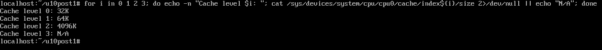

# salas-post1-u10 — Memorias del computador: jerarquía de caché y memoria virtual

**Autor:** César Hernán Salas Peñaranda  
**Curso:** Arquitectura de Computadores — Unidad 10, post-contenido (laboratorio en dos partes)  
**Repositorio único:** `salas-post1-u10`

Este repositorio reúne las dos partes del laboratorio de memoria en lenguaje C sobre Linux. La Parte 1 mide con un benchmark propio el efecto de la jerarquía de caché sobre la latencia de acceso, incluido un patrón con stride fijo que expone conflictos de asociatividad. La Parte 2 examina la memoria virtual de un proceso Linux a través de `/proc`, el comportamiento del page fault agregado y el costo de un page fault individual con `mmap`.

## Entorno de trabajo

| Componente | Detalle |
|---|---|
| Sistema anfitrión | Windows 11 Home, procesador Intel Core Ultra 5 226V, 16 GB de RAM |
| Hipervisor | VirtualBox 7.2.22 |
| Máquina virtual | `U10-Alpine`: 2 CPU, 2048 MB de RAM, red NAT, sin disco |
| Sistema invitado | Alpine Linux 3.24.4 (kernel 6.18.60-lts) arrancado en modo *live* desde el ISO, con `root` sin contraseña |
| Compilador | `gcc` 15.2.0 (musl libc 1.2.6) |
| Herramientas | `pmap`, `vmstat` y `free` (`procps-ng`), `/usr/bin/time` (GNU `time`), `lscpu` (`util-linux`) |

La guía recomienda Ubuntu 20.04 o equivalente. El estudiante reutilizó el ISO de Alpine que ya tenía de la Unidad 5 y creó una VM nueva y desechable, sin tocar la del laboratorio anterior. Alpine usa **musl** en lugar de glibc, así que en los mapas de memoria de la Parte 2 la librería de C aparecerá como `libc.musl-x86_64.so.1` y el cargador como `ld-musl-x86_64.so.1`, en lugar de `libc.so` y `ld-linux.so`.

Los paquetes se instalaron con `apk` desde los repositorios oficiales de Alpine:

```
apk add gcc musl-dev procps-ng time util-linux
```

Los archivos `.c` se escriben en el anfitrión, dentro de este repositorio, y la VM los descarga desde un servidor HTTP local temporal que solo la VM alcanza (`10.0.2.2`). Los resultados se leen en la consola de la VM y se capturan con `VBoxManage controlvm screenshotpng`, que captura únicamente la pantalla de la VM.

## Estructura del repositorio

```
salas-post1-u10/
├── README.md
├── u10post1/       # Parte 1: cache_bench.c
├── u10post2/       # Parte 2: mymaps.c, pagefault_demo.c, mmap_fault_cost.c
└── capturas/       # capturas de la consola de la VM, nombradas pN_cpM_descripcion.png
```

---

# Parte 1 — Benchmark de jerarquía de caché

## Paso 1 — Configuración del entorno y detección de caché

El estudiante creó el directorio de trabajo y consultó la topología de caché que el kernel expone en `/sys/devices/system/cpu/cpu0/cache/`:

```
mkdir -p ~/u10post1 && cd ~/u10post1
for i in 0 1 2 3; do
   echo -n "Cache level $i: "
   cat /sys/devices/system/cpu/cpu0/cache/index${i}/size 2>/dev/null || echo "N/A"
done
```

Además de los tamaños, leyó la geometría de cada nivel (nivel, tipo, vías, tamaño de línea y número de sets), porque la decisión técnica del Paso 5 depende de ella.

| Nivel | Tipo | Tamaño | Vías | Línea | Sets |
|---|---|---|---|---|---|
| L1 (`index0`) | Datos | 32 KB | 8 | 64 B | 64 |
| L1 (`index1`) | Instrucciones | 64 KB | 8 | 64 B | 128 |
| L2 (`index2`) | Unificada | 4096 KB (4 MB) | 16 | 64 B | 4096 |
| L3 (`index3`) | — | N/A | — | — | — |

**Observaciones.**

- La caché L1 de datos es de 32 KB, de 8 vías y con líneas de 64 bytes: 32 KB / (8 vías × 64 B) = 64 sets. Es exactamente la geometría de ejemplo que usa la guía en las decisiones técnicas.
- **La VM no expone una caché L3**: `index3` no existe, y por eso el bucle de la guía imprime `N/A` en el nivel 3. Los valores son los que el hipervisor presenta al invitado, que pueden diferir de la jerarquía física del procesador; el anfitrión (Windows) informa 8 MB de L3 para este procesador, pero esa información no llega a la VM. Esto se tiene en cuenta al interpretar los saltos del benchmark.
- `lscpu` confirma que el invitado corre sobre un hipervisor (`KVM`) y que ve 2 CPU.

**Checkpoint 1.** Tamaños detectados: L1d = 32 KB, L2 = 4 MB, L3 = no expuesta por la VM.



